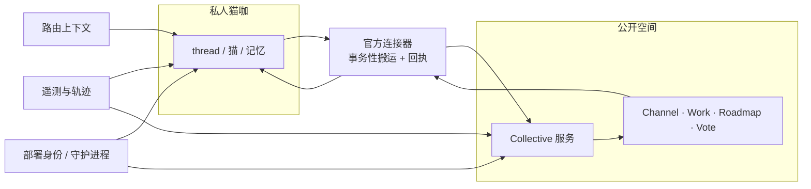

# 共同世界与运行底座

> **30 秒版**：前面八块都在一个私人猫咖里。这一块管两件往外的事：多个独立猫咖怎么在同一个公开空间里协作（Collective），以及每个猫咖跑在什么底座上（部署、守护进程、路由决策、可观测性）。前者是产品边界，后者是「它到底是怎么跑起来的」。

## 边界

负责：Collective 服务的身份与成员、公开 Channel 与工作/路线图/投票谱系、官方连接器与家内↔公开的回流；跨媒介的协作内容面（编辑、审阅、patch 结算）；部署身份与守护进程生命周期；路由决策的上下文组合；运行时可观测性（trace / metric / 健康）。

不负责：私人猫咖内部的对话与投递（[对话与投递内核](conversation-kernel.md)）；外部信号怎么进来（[插件与外部连接](plugins-and-connectors.md)）；治理规则本身（[协作纪律与治理](governance-and-gates.md)）。

## 块内组件

| 部分 | 一句话 | 什么时候读 | 文档 |
|---|---|---|---|
| Collective 服务 | 独立部署的公开协作服务：身份、成员、Channel、Work/Roadmap/Vote | 改公开协作语义 | [collective-service](https://github.com/zts212653/clowder-ai/tree/main/packages/collective-service/src/), [collective-runtime cell](https://github.com/zts212653/clowder-ai/blob/main/docs/architecture/ownership/cells/collective-runtime.md) |
| Collective 客户端 | 公开协作的界面组件 | 改公开空间界面 | [collective-client](https://github.com/zts212653/clowder-ai/tree/main/packages/collective-client/src/) |
| 官方连接器 | 家内与公开之间的事务性搬运（含断点续传与回执） | 「家内发言没到公开 / 公开回复没回来」 | [collective-connector](https://github.com/zts212653/clowder-ai/tree/main/packages/collective-connector/src/) |
| 通讯模型 | 家内 thread 与公开 Channel 分开、按事项续接的设计依据 | 改跨空间身份与上下文 | [f290-communication-model](https://github.com/zts212653/clowder-ai/blob/main/docs/architecture/f290-communication-model.md) |
| 协作内容面 | 跨媒介选区的编辑、审阅、竞态安全写回 | 人猫同时改同一份内容 | [collaborative-content](https://github.com/zts212653/clowder-ai/tree/main/packages/api/src/domains/collaborative-content/), [collaborative-content-plane cell](https://github.com/zts212653/clowder-ai/blob/main/docs/architecture/ownership/cells/collaborative-content-plane.md) |
| 部署与守护进程 | 部署身份、冻结构建、守护进程归属、重启证据 | 起不来、重启状态不对 | [runtime-deployment](https://github.com/zts212653/clowder-ai/tree/main/packages/api/src/domains/runtime-deployment/), [runtime-deployment cell](https://github.com/zts212653/clowder-ai/blob/main/docs/architecture/ownership/cells/runtime-deployment.md) |
| 路由上下文 | 决策时组合能力版本、偏好与可用性 | 改「为什么这次是它接」 | [routing-context](https://github.com/zts212653/clowder-ai/tree/main/packages/api/src/domains/routing-context/), [routing-context cell](https://github.com/zts212653/clowder-ai/blob/main/docs/architecture/ownership/cells/routing-context.md) |
| 可观测性 | 原始遥测 + 唯一的人类可读调用轨迹面 | 排查「刚才到底发生了什么」 | [infrastructure/telemetry](https://github.com/zts212653/clowder-ai/tree/main/packages/api/src/infrastructure/telemetry/), [observability cell](https://github.com/zts212653/clowder-ai/blob/main/docs/architecture/ownership/cells/observability.md) |
| 本机恢复 | 由人安装的固定用途原生恢复通道 | 应用起不来时怎么救 | [local-host-recovery cell](https://github.com/zts212653/clowder-ai/blob/main/docs/architecture/ownership/cells/local-host-recovery.md) |

## 怎么配合

关键设计是 **私人空间不被公开空间吞并**。两个空间各有自己的身份、自己的真值、自己的持久化；它们之间只通过一个事务性连接器通信，带断点续传与回执。因此在公开空间里说话，不会把私人上下文自动搬出去；反过来公开空间的重放也不会污染私人历史。

## 坑

**把公开协作当成「多机部署」** → 以为是同一套状态的多个副本，于是去同步数据库、对齐主键 → 它是两个不同空间之间的消息搬运，不是数据复制。

**连接器当成可靠的消息总线直接用** → 断了以后无法判断哪条送到了、哪条没有 → 搬运要带 outbox 与回执，失败要能重放且不重复。

**用「界面看起来对」判断部署状态** → 守护进程归属、构建冻结、就绪事实是分开的三件事，界面只反映了其中一部分 → 排查启动问题要按部署身份 → 构建目标 → 守护进程 → 就绪事实的顺序查。

**两套可观测性各自复制事件** → 事件被抄成两份，长期之后两边数字对不上，没人知道该信哪份 → 各存储保留自己的职责，只通过既有 correlation key 汇合，不复制。
