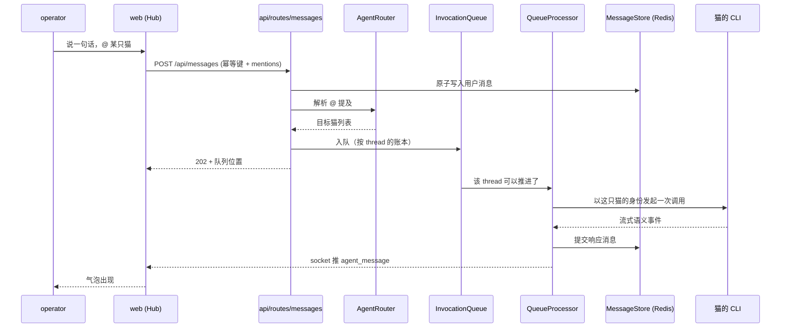

# 对话与投递内核

> **30 秒版**：Clowder 里一切协作都长在 thread 上，而 thread 里发生的一切都是消息。这一块负责「一条消息怎么从你的输入框走到猫、再走回来变成气泡」——HTTP 入口、@ 路由、按 thread 的队列账本、执行器、消息存储、以及前端那套唯一的会话运行时。它是全仓改动最热的地方。

## 边界

负责：用户消息的接收入口与幂等、@ 提及到目标猫的解析、按 thread 持久化的排队与出队、一次 invocation 的执行生命周期、消息的 canonical 写入、provider 事件到用户可见气泡的投影、以及浏览器端渲染与实时推送。

不负责：谁该负责推进下一步（交给 [球权与等待责任](ball-custody.md)）；猫是谁、用什么模型、什么人格（交给 [猫与身份](cats-and-identity.md)）；消息里提到的历史知识（交给 [记忆与证据](memory-and-evidence.md)）。猫与猫之间的 `@` 也走这里的路由，但它只是路由，不是责任判定。

## 块内组件

| 部分 | 一句话 | 什么时候读 | 文档 |
|---|---|---|---|
| HTTP 入口 | `POST /api/messages`：原子创建调用记录 → 写用户消息 → 回 202 → 后台执行 | 改发送协议、加字段、查为什么先回 202 | [messages.ts](https://github.com/zts212653/clowder-ai/blob/main/packages/api/src/routes/messages.ts) |
| @ 路由 | 解析 `@猫`、`@all`、无提及时的兜底；路由层故意做成机械的 | 改「这条消息该叫醒谁」 | [AgentRouter](https://github.com/zts212653/clowder-ai/tree/main/packages/api/src/domains/cats/services/agents/routing/), [路由系统说明](https://github.com/zts212653/clowder-ai/blob/main/docs/architecture/at-mention-routing-system.md) |
| 队列账本 | 按 thread 持久化的待办与活跃索引；内存 map 只是投影 | 排查卡住、重复执行、顺序错乱 | [InvocationQueue / QueueProcessor](https://github.com/zts212653/clowder-ai/tree/main/packages/api/src/domains/cats/services/agents/invocation/), [ADR-043](https://github.com/zts212653/clowder-ai/blob/main/docs/decisions/043-queue-durable-single-ledger.md) |
| 消息存储 | 消息与 thread 的 canonical 存储（Redis） | 加字段、改读写语义、查数据丢了 | [stores](https://github.com/zts212653/clowder-ai/tree/main/packages/api/src/domains/cats/services/stores/) |
| 消息编排 | 发送、追加、快照、分页、事件流 | 改消息合并、附件、分页 | [domains/messaging](https://github.com/zts212653/clowder-ai/tree/main/packages/api/src/domains/messaging/) |
| 气泡投影 | provider 语义事件 → 用户可见气泡的唯一投影边界 | 「界面显示的和实际发生的不一致」 | [bubble-pipeline cell](https://github.com/zts212653/clowder-ai/blob/main/docs/architecture/ownership/cells/bubble-pipeline.md) |
| 前端会话运行时 | 浏览器端唯一的 thread chat runtime 消费者 | 改聊天界面、加新布局 | [useSendMessage](https://github.com/zts212653/clowder-ai/blob/main/packages/web/src/hooks/useSendMessage.ts), [thread-chat-surface cell](https://github.com/zts212653/clowder-ai/blob/main/docs/architecture/ownership/cells/thread-chat-surface.md) |
| 气泡渲染 | 投影结果怎么画成一行：`ChatContainer` 管列表与滚动，`ChatMessageRow` 管行的结构与元信息，`ChatMessage` 管气泡本体（思考、CLI 记录、工具结果） | 改聊天气泡长什么样 | [ChatContainer](https://github.com/zts212653/clowder-ai/blob/main/packages/web/src/components/ChatContainer.tsx), [ChatMessageRow](https://github.com/zts212653/clowder-ai/blob/main/packages/web/src/components/ChatMessageRow.tsx), [ChatMessage](https://github.com/zts212653/clowder-ai/blob/main/packages/web/src/components/ChatMessage.tsx) |
| 线程组织 | 标签、置顶、收藏、侧栏筛选与权威快照 | 改侧栏、加一种组织方式 | [thread-navigation cell](https://github.com/zts212653/clowder-ai/blob/main/docs/architecture/ownership/cells/thread-navigation.md) |
| 渠道出入口 | IM/设备渠道进来出去的消息规范化 | 接飞书/Telegram/小艺等外部消息 | [Transport Plane cell](https://github.com/zts212653/clowder-ai/blob/main/docs/architecture/ownership/cells/transport.md), [插件与外部连接](plugins-and-connectors.md) |

## 怎么运转

这张图的关键取舍是**写入与执行解耦**：接住消息、回执 202、后台执行三件事分开，所以界面不会因为猫跑得慢而卡住，也不会因为浏览器关掉而丢掉一次委托。代价是「已接受」和「已完成」之间多了一个需要持久化的状态窗口——那个窗口就是下面队列账本要负责的东西。

分步走一遍，就是根节点那条走查：你按下发送 → [messages.ts](https://github.com/zts212653/clowder-ai/blob/main/packages/api/src/routes/messages.ts) 接住并立刻回 202 → [AgentRouter](https://github.com/zts212653/clowder-ai/tree/main/packages/api/src/domains/cats/services/agents/routing/) 决定叫醒谁 → [InvocationQueue](https://github.com/zts212653/clowder-ai/tree/main/packages/api/src/domains/cats/services/agents/invocation/) 把它排进这个 thread 的账本 → [QueueProcessor](https://github.com/zts212653/clowder-ai/tree/main/packages/api/src/domains/cats/services/agents/invocation/) 出队并以那只猫的身份调起 CLI → 响应写回 [MessageStore](https://github.com/zts212653/clowder-ai/tree/main/packages/api/src/domains/cats/services/stores/) → socket 推送 → 气泡出现。

## 坑

**在 QueueProcessor 之后就不再 drain 一次队列** → 队列非空却没人继续推进，thread 静默卡住，直到下一次有人说话才恢复 → 每次 `onInvocationComplete` 之后都要再 drain 一次，让「队列非空且无 drain」这个状态不可能稳定存在。

**以为消息序号（seq）是持久真相** → 序号是每实例内存态、按单实例部署假设生成，重启后从 1 重新计数（靠实例 epoch 让前端察觉重启并重新对齐）→ 序号只用于实时推送的排序与补洞，需要持久顺序时读存储，不要拿 seq 当主键或时间线。

**把消息追加当成「先读后写」** → 并发追加时丢失或重复（历史上就是 `feat: complete unified message delivery lifecycle` 之前的一类事故） → 追加要走存储层的原子 + 幂等路径，不要自己在业务层拼「读-合并-写」。

**在前端组件里改「显示什么」** → 越过投影层直接拼装气泡内容，结果同一条语义事件在历史回放和实时推送里长得不一样（历史走服务端存储、实时走 socket），且每次改文案要动两处 → 分清两层：`packages/web/src/components/` 下的 `ChatContainer` / `ChatMessageRow` / `ChatMessage` 只决定**怎么画**（布局、间距、折叠、主题），气泡**内容本身**由气泡投影产出；要改内容去 [bubble-pipeline](https://github.com/zts212653/clowder-ai/blob/main/docs/architecture/ownership/cells/bubble-pipeline.md) 那条线。渲染的跨消息投影键在 `chat-timeline-projection-key.ts`，别为了让内容更新去撑大它——那会让历史气泡失去记忆化。

**不传 threadId 就发消息** → 消息落到名为 `default` 的大厅 thread，看起来「发出去了」但不在你以为的会话里。在前端它更隐蔽：`default` 恰好是「新会话首页」的判据（`ChatContainer` 里 `threadId === 'default'` 时渲染落地页），所以你会在首页看到一条属于大厅的消息，而不会看到它挂在某个会话上 → 所有调用方都显式带上 threadId，只有大厅场景才用 `default`。
