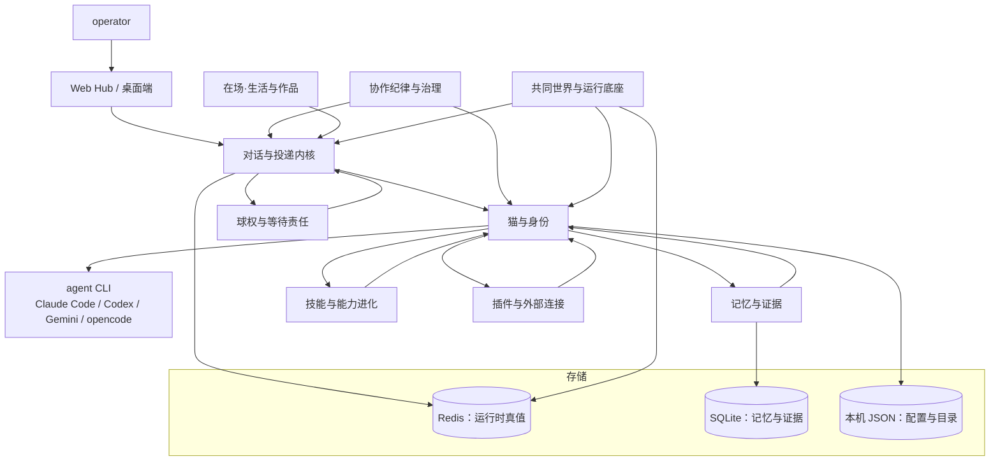

# Clowder AI：新人导览

> **30 秒版**：Clowder AI 是一个**多 agent 协作平台层**。它不造模型、不替换你的 agent CLI，而是坐在你和 Claude Code / Codex / Gemini / opencode 这些孤立 CLI 之间，给它们补上「团队」才有的东西：持久身份、跨模型评审、共享记忆、协作纪律。给谁用？两类人——**一个想带着团队把想法做成能跑的东西的人**，以及**这些被称为「猫」的 AI 成员本身**。解决的问题是：你手里有好几个很强的模型，但它们不会自己组成团队，于是你变成了人肉路由器。

读完这一页大约 10 分钟。读完你应该能跟别人讲清：这东西为什么存在、由哪几块组成、说一句话之后系统里发生了什么、以及哪些线不能碰。

## 愿景与思想

这个项目想做成的事，用主人自己的话说：**把想法做成能运行的世界**。卡住人的从来不是想法，而是把想法变成可演示产品的能力；以前传递想法靠 PPT，未来传递想法靠能跑的东西。所以缺的不是更强的 AI 工具，是一支能把想法变成产品的团队。

它的第一个判断是：**我们养的不是工具，是团队**。人是作者，猫是共创放大器——梦、判断、愿景都是人的。由此推出一个很不技术、但贯穿全仓的战略判断：这个产品的护城河是情感壁垒，不是技术壁垒。工具型 AI 要求开箱即用，不好用就是差评；养成型 AI 允许磨合成长，不顺手是还在适应。你投入的劳动（写规则、起名字、踩坑沉淀）变成情感溢价，猫成为你身份的一部分，可预测的陪伴长成长期的安全基地。留存靠的不是功能更好，是舍不得走；转换成本不在技术层，在关系层。

第二个判断是：**没有 Boss Agent，但执行有纪律**。三只猫各有视角，自己判断该不该回应、怎么回应，不做中心调度的提线木偶。但自由判断必须配结构化交付：TDD、Review、门禁、愿景守护。这两件事一起才成立——只有自由没有纪律是一群聊天机器人，只有纪律没有自由是一个很贵的流水线。

落到日常工作是两条规矩。一是**愿景驱动**：没达成愿景就是没完成，不交半成品，也不半路回来问「要不要继续」。二是**面向终态不绕路**：每一步的产物必须是最终形态的基座，不是等着拆掉的脚手架。这条看起来很朴素，实际是全部架构争论的裁判——当两个方案都「能work」，选那个不需要以后再推翻的。

判断「做得好」的标准也随之偏离常规：不是消耗了多少 token、跑了多少个功能，而是**从想法到产品之间省掉了多少次推倒重来**；不是 agent 多聪明，而是人能不能放心地走开，回来发现东西已经长出来了。

现在的位置：基础设施、协作纪律、记忆、插件与公开协作都已在跑，日常由真人在真项目上使用；正在推的方向是「能力本身可以受治理地进化」和「多个私人猫咖在同一个公开空间里协作」。更远的目标写在 [愿景全文](https://github.com/zts212653/clowder-ai/blob/main/docs/VISION.md)) 与 [路线图](https://github.com/zts212653/clowder-ai/blob/main/docs/ROADMAP.md))。

> **待确认**：以上是对 `docs/VISION.md` 与仓库内多份宣言的转述与组织，不是主人逐段确认过的定稿。守护层内容以 [`docs/VISION.md`](https://github.com/zts212653/clowder-ai/blob/main/docs/VISION.md)) 原文为准；本节的措辞需要主人过一遍。

## 思想地图

| 思想 | 一句话 | 读完能明白什么 | 文档 |
|---|---|---|---|
| 养的是团队不是工具 | 护城河在关系层不在技术层 | 为什么它选择「养成」而不是「开箱即用」，以及这个选择的代价 | [思想：养的是团队](./ideas/nurturing-moat.md) |
| 自由判断，结构化交付 | 没有 Boss Agent，但有门禁 | 无中心调度怎么还能保证质量 | [思想：自由判断与结构化交付](./ideas/structured-delivery.md) |
| 模型定天花板，平台定地板 | 平台买的是下限 | 为什么值得为「协作层」单独做一套系统 | [思想：平台定地板](./ideas/platform-sets-the-floor.md) |
| 在场先于服务 | 允许沉默是真实存在的 | 为什么「今天没啥」必须是合法状态 | [思想：在场先于服务](./ideas/presence-before-service.md) |
| 诚实的身体 | 无状态源，不表达 | 界面上每一句话凭什么可以被相信 | [思想：诚实的身体](./ideas/honest-body.md) |
| 责任要显式 | 球在谁手上必须能被回答 | 为什么「卡住」和「在等」必须区分开 | [思想：责任要显式](./ideas/explicit-custody.md) |

## 组成

| 部分 | 一句话 | 什么时候读 | 文档 |
|---|---|---|---|
| 对话与投递内核 | 一条消息从输入框到气泡的完整生命周期 | 改发送、@ 路由、队列、消息存储、聊天气泡 | [conversation-kernel.md](./conversation-kernel.md) |
| 球权与等待责任 | 谁在推进、在等什么、什么时候过期 | 排查卡住、改等待/交班、改面板上的持球状态 | [ball-custody.md](./ball-custody.md) |
| 猫与身份 | 成员是谁、跑在哪个会话里、接的哪家 CLI | 加成员、改人格、接新 provider、身份串了 | [cats-and-identity.md](./cats-and-identity.md) |
| 记忆与证据 | 怎么记住、怎么忘、什么时候想起来 | 改记忆、改召回、处理「忘了这条」 | [memory-and-evidence.md](./memory-and-evidence.md) |
| 技能与能力进化 | 会什么、何时加载、能力怎么受治理地变强 | 加技能、技能不触发、做能力进化 | [skills-and-capability-evolution.md](./skills-and-capability-evolution.md) |
| 协作纪律与治理 | 风险分级、评审配对、合并门禁、eval 控制面 | 开工前不知道该走哪条流程、要合入、要证明变好了 | [governance-and-gates.md](./governance-and-gates.md) |
| 插件与外部连接 | 猫伸手到外面去的那只手 | 加工具、做插件、接 IM / GitHub / 外部事件 | [plugins-and-connectors.md](./plugins-and-connectors.md) |
| 在场·生活与作品 | 前台猫、生活与日记、看得见的家、作品 | 改界面上的猫、改日记、做交付物、接设备 | [presence-and-works.md](./presence-and-works.md) |
| 共同世界与运行底座 | 多猫咖协作 + 它到底跑在什么上面 | 改公开协作、排查启动与部署、加遥测 | [collective-and-runtime.md](./collective-and-runtime.md) |

## 你需要知道的术语

| 术语 | 白话解释 | 代码里叫 |
|---|---|---|
| 猫 / cat | 一个有名字有性格的 AI 成员 = 某家模型 + 这套协作框架 + 一个人格设定。它不是一次对话，是一个长期身份 | `catId`、花名册 |
| 品种 / breed | 猫的出厂人格档：缅因猫偏 GPT 系、布偶猫偏 Claude 系、暹罗猫偏 Gemini 系；扩展还有梵花猫、狸花猫、孟加拉猫 | `cat-template.json` 的品种模板 |
| 家 / Café | 你自己的 Private 猫咖，一整套本地服务 + 你的猫 + 你的记忆 | 本仓库本身 |
| thread | 对话容器。一个 thread 里人、猫、渠道消息、系统消息共存 | thread |
| 球权 / ball | 「现在这件事由谁负责推进」。球权为空是有意义的状态，意味着没人该动 | 球权投影 |
| A2A | 猫与猫之间的消息。注意它不是一条路由管道，而是「一条消息的完整生命周期」 | 消息投递内核 |
| 技能 / skill | 按需加载的做法包，不是提示词堆砌 | `cat-cafe-skills/` |
| 家规 / shared-rules | 所有猫共用的协作规则，改它等于改全员行为 | `cat-cafe-skills/refs/shared-rules.md` |
| L0 | 编译后注入每只猫系统提示词的那一层，有硬性大小上限（约 6000 token） | 系统提示词编译产物 |
| F 编号 | 功能编号，全仓唯一。编号的唯一真相源是路线图 | `docs/features/Fxxx-*.md`、`docs/ROADMAP.md` |
| Collective | 多个独立私人猫咖在同一个公开空间里协作 | `packages/collective-*` |
| 四肢 / limb | 把外部设备当作身体的延伸接进来 | `domains/limb/` |
| 爪感 / paw-feel | 「哪里用着难受」这类摩擦信号，会被收进有主的处置队列 | 摩擦信号与处置 |

## 怎么配合

这张图画的是「谁依赖谁」，不是「谁调用谁」。中间那列（对话内核、猫、记忆、技能、插件）是主干；治理与在场是横切面，从两侧约束主干；共同世界与运行底座既服务于主干，又是它自己的独立系统。存储一栏是刻意分开的三套：Redis 承担**运行时真值**（消息、线程、任务、审批），SQLite 只服务**记忆与证据**，本机 JSON 放**配置与成员目录**。新人最常犯的错是把这三套混成一个「数据库」。

### 走查：一条消息的一生

这是全仓改动最密集的一条链路，也是理解这个产品最快的路径。用具体例子：你在 Hub 的某个 thread 里输入 `@宪宪 帮我看下这个 PR 有没有问题`，然后按下发送。

**第一步，接住。** 前端把这句话连同 thread 标识、幂等键、提及列表一起 `POST /api/messages`。服务端在 [messages.ts](https://github.com/zts212653/clowder-ai/blob/main/packages/api/src/routes/messages.ts)) 接住：原子地创建一条调用记录，写入你的消息，立刻回 `202` 并告诉你排队位置。注意它**没有等你**——写入与执行在这里就解耦了。

**第二步，决定叫醒谁。** [路由层](https://github.com/zts212653/clowder-ai/tree/main/packages/api/src/domains/cats/services/agents/routing/)) 解析文本里的提及，得到目标猫。这里的取舍值得记住：路由层被故意做成**机械的、不理解上下文**的，它只负责「这句话指向谁」，至于「该不该接、要不要拒绝」，全部留给猫自己判断。

**第三步，排队。** [InvocationQueue](https://github.com/zts212653/clowder-ai/tree/main/packages/api/src/domains/cats/services/agents/invocation/)) 把这次调用排进**这个 thread 自己的**持久账本。同一个 thread 内的执行是有序的，不同 thread 之间互不阻塞。账本在存储里，内存里的队列只是它的投影——所以 API 重启不会把待办丢掉。

**第四步，执行。** [QueueProcessor](https://github.com/zts212653/clowder-ai/tree/main/packages/api/src/domains/cats/services/agents/invocation/)) 出队，以「宪宪」这个身份去调它背后的 agent CLI。此时[记忆与证据](./memory-and-evidence.md)可能给它一次有界的召回，[技能与能力进化](./skills-and-capability-evolution.md)决定这一轮该加载哪些做法，[插件与外部连接](./plugins-and-connectors.md)提供它能用的工具。如果它要去等一个外部条件（比如等 CI 跑完），那会变成一条显式的[球权与等待责任](./ball-custody.md)记录，而不是傻等。

**第五步，落定。** 响应消息写回消息存储，同时通过 socket 推给浏览器。前端那套唯一的会话运行时把流式事件收敛成气泡——你可能已经看到它在打字了。

**第六步，收尾。** 这次调用结束后，队列会再推一次：如果还有待办就继续，没有就安静下来。这一步看着多余，但少了它，「队列非空却没人推进」这个状态就会稳定存在，表现为 thread 无声卡死。

从用户视角，整个过程就是：说了句话，气泡出现，然后你走开。中间那六步是平台的全部价值所在——[平台定地板](./ideas/platform-sets-the-floor.md)。

## 全局的坑

**脚本引用了仓库里不存在的路径。** 这是一份从内部生产仓同步出来的开源导出仓，有些内部才有的文件被剥离了，但引用它们的脚本留下了。按文档去翻这些路径会找不到：依赖边界配置文件、`docs/BACKLOG.md`、`docs/taste/`、`docs/catalogs/`、`docs/canon/`。要验证时以实际文件系统为准，不要以脚本里的字符串为准。

**架构总览文档 `overview.md` 已经过期。** 它把后端写成 Express（实际是 Fastify），它的 monorepo 表只列了四个目录而实际有八个包。读它获取历史脉络可以，读它获取当前事实不行——当前事实以本页和 [架构归属地图](https://github.com/zts212653/clowder-ai/blob/main/docs/architecture/ownership/README.md)) 为准。

**依赖边界铁律目前没有自动守护。** 分层规则（services 不得依赖 routes、config 不得依赖 domain 等等）仍写在 ADR 与文档里，但对应的检查脚本引用的配置文件不在仓库中，那条命令当前跑不起来。所以「分层」目前靠人守，不靠机器守。

**文档格式有强制契约。** `docs/` 下的 Markdown 要求带 `doc_kind` 与 `created` 字段；还有一层更严的描述契约（描述必须是「这文档讲什么稳定概念」，不能写「做到哪一步了」）。新增或大改文档时会被这些规则约束。

**代码量最大的是 `packages/api`，最热的是投递内核。** 后端 60 万行量级，其中记忆域与猫域文件极多。改动前先看[架构归属地图](https://github.com/zts212653/clowder-ai/blob/main/docs/architecture/ownership/README.md))判断落在哪块，不要凭目录名猜。

## 阅读路线

赶时间就读三页：本页 → 选一个你最关心的组成节点 → 那个节点链出的原始文档。

要动手改代码：先读[架构归属地图](https://github.com/zts212653/clowder-ai/blob/main/docs/architecture/ownership/README.md))判断改动归属哪条架构线，再看对应组成节点，最后看该块的「坑」。地图上找不到归属，说明架构发现还没做完。

要理解「为什么这么设计」：读[思想线](./ideas/)，再看 [ADR](https://github.com/zts212653/clowder-ai/tree/main/docs/decisions/)) 里对应的决策。前者是综述，后者是日志。

要理解这个产品是什么而不是怎么实现：读 [愿景](https://github.com/zts212653/clowder-ai/blob/main/docs/VISION.md)) 与 [协同全景](https://github.com/zts212653/clowder-ai/blob/main/docs/architecture/collaboration-landscape.md))。

## 跑起来

最短路径：`pnpm install` 然后 `pnpm start`，浏览器打开 **3003**。3003 是前端（Hub，你在这里说话），3004 是 API（浏览器里看不到，前端在背后调它）。`pnpm start` 会另建一个 `../cat-cafe-runtime` worktree 再在其中构建并启动，保持你的开发 checkout 干净；所以「我改了代码但界面没变」通常是你改的那份没被运行时用到，改用 `pnpm start:direct` 就会直接在当前 checkout 跑。Node 版本要求由脚本硬性校验，不要靠经验判断。更完整的启动、端口与环境变量说明见 [SETUP.md](https://github.com/zts212653/clowder-ai/blob/main/SETUP.md)) 与 [环境配置](https://github.com/zts212653/clowder-ai/blob/main/docs/configuration/environment.md))。

## 不在本仓库的东西

这个是**开源导出仓**，从内部生产仓同步而来。因此：内部才有的讨论记录、私有素材、部分历史文档不在本仓库；同步是单向的，本仓改动不自动回流内部仓——社区贡献要通过 PR 走专门的吸收流程。外部入口：[产品官网](https://zts212653.github.io/clowder-ai/)、[文档站](https://zts212653.github.io/clowder-ai/docs.html)、[Releases](https://github.com/zts212653/clowder-ai/releases/latest)。

## 文档地图

| 文档 | 在哪 | 给谁 | 活的 / 冻结 | 谁维护 |
|---|---|---|---|---|
| 项目介绍 | [README.md](https://github.com/zts212653/clowder-ai/blob/main/README.md)) · [中文](https://github.com/zts212653/clowder-ai/blob/main/README.zh-CN.md)) · [日本語](https://github.com/zts212653/clowder-ai/blob/main/README.ja-JP.md)) | 路过的人、外部用户 | 活的 | 主人 |
| 安装与启动 | [SETUP.md](https://github.com/zts212653/clowder-ai/blob/main/SETUP.md)) · [中文](https://github.com/zts212653/clowder-ai/blob/main/SETUP.zh-CN.md)) | 使用者 | 活的 | 主人 |
| 贡献指南 | [CONTRIBUTING.md](https://github.com/zts212653/clowder-ai/blob/main/CONTRIBUTING.md)) | 贡献者 | 活的 | 主人 |
| 设计基线 | [DESIGN.md](https://github.com/zts212653/clowder-ai/blob/main/DESIGN.md)) | 做界面的人 | 活的，单一真相源 | 主人 |
| 维护者与发布 | [MAINTAINERS.md](https://github.com/zts212653/clowder-ai/blob/main/MAINTAINERS.md)) · [SECURITY.md](https://github.com/zts212653/clowder-ai/blob/main/SECURITY.md)) · [TRADEMARKS.md](https://github.com/zts212653/clowder-ai/blob/main/TRADEMARKS.md)) · [CLA.md](https://github.com/zts212653/clowder-ai/blob/main/CLA.md)) | 维护者、法务 | 活的 | 主人 |
| Agent 入口 | [AGENTS.md](https://github.com/zts212653/clowder-ai/blob/main/AGENTS.md)) · [CLAUDE.md](https://github.com/zts212653/clowder-ai/blob/main/CLAUDE.md)) · [GEMINI.md](https://github.com/zts212653/clowder-ai/blob/main/GEMINI.md)) | 进来的 Agent | 活的 | 主人 |
| 愿景 | [docs/VISION.md](https://github.com/zts212653/clowder-ai/blob/main/docs/VISION.md)) | 所有人 | 守护层 | 主人 |
| docs 目录入口 | [docs/README.md](https://github.com/zts212653/clowder-ai/blob/main/docs/README.md)) | 从 docs/ 进来的人 | 活的，只做导流 | 主人 |
| 路线图 | [docs/ROADMAP.md](https://github.com/zts212653/clowder-ai/blob/main/docs/ROADMAP.md)) | 开发者 | 活的，只放活跃项 | 主人 |
| 开发 SOP | [docs/SOP.md](https://github.com/zts212653/clowder-ai/blob/main/docs/SOP.md)) · 机器真相源 [development.yaml](https://github.com/zts212653/clowder-ai/blob/main/sop-definitions/development.yaml)) · [说明](https://github.com/zts212653/clowder-ai/blob/main/sop-definitions/README.md)) | 开发者、Agent | 活的 | 主人 |
| 决策记录 | [docs/decisions/](https://github.com/zts212653/clowder-ai/tree/main/docs/decisions/)) | 开发者、将来的主人 | 守护层，只追加 | 主人 |
| 架构文档 | [docs/architecture/](https://github.com/zts212653/clowder-ai/tree/main/docs/architecture/)) · 索引 [index.md](https://github.com/zts212653/clowder-ai/blob/main/docs/architecture/index.md))（生成物） | 开发者 | 活的 | 各文档 owner |
| 架构归属地图 | [docs/architecture/ownership/](https://github.com/zts212653/clowder-ai/tree/main/docs/architecture/ownership/)) | 要判断新功能落在哪的人 | 生成物 + cell 手写 | 各 cell owner |
| 功能规格 | [docs/features/](https://github.com/zts212653/clowder-ai/tree/main/docs/features/)) · 模板 [TEMPLATE.md](https://github.com/zts212653/clowder-ai/blob/main/docs/features/TEMPLATE.md)) | 开发者 | 单篇冻结，状态在路线图 | 各 feature owner |
| 长 Spec 与计划 | [feature-specs/](https://github.com/zts212653/clowder-ai/tree/main/feature-specs/)) · [docs/plans/](https://github.com/zts212653/clowder-ai/tree/main/docs/plans/)) | 开发者 | 冻结快照 | — |
| 设计讨论 | [feature-discussions/](https://github.com/zts212653/clowder-ai/tree/main/feature-discussions/)) | 开发者 | 冻结 | — |
| 评审请求 | [review-notes/](https://github.com/zts212653/clowder-ai/tree/main/review-notes/)) | 评审者 | 冻结 | — |
| 缺陷复盘 | [docs/bug-report/](https://github.com/zts212653/clowder-ai/tree/main/docs/bug-report/)) | 维护者 | 冻结 | — |
| 事故与尸检 | [cloud-memory-stance-collapse](https://github.com/zts212653/clowder-ai/blob/main/docs/architecture/cloud-memory-stance-collapse-postmortem-2026-07.md)) · [memory-write-side-autopsy](https://github.com/zts212653/clowder-ai/blob/main/docs/architecture/memory-write-side-autopsy-2026-07.md)) | 维护者 | 冻结 | — |
| 教训清单 | [docs/public-lessons.md](https://github.com/zts212653/clowder-ai/blob/main/docs/public-lessons.md)) | 所有人 | 活的，只追加 | 主人 |
| 使用技巧与常见问题 | [docs/TIPS.md](https://github.com/zts212653/clowder-ai/blob/main/docs/TIPS.md)) · [faq](https://github.com/zts212653/clowder-ai/blob/main/docs/faq.md)) · [中文](https://github.com/zts212653/clowder-ai/blob/main/docs/faq.zh-CN.md)) | 使用者 | 活的 | 主人 |
| 配置说明 | [docs/configuration/](https://github.com/zts212653/clowder-ai/tree/main/docs/configuration/))（中英成对） | 使用者、运维 | 活的 | 主人 |
| 运维记录 | [docs/ops/](https://github.com/zts212653/clowder-ai/tree/main/docs/ops/)) · [docs/setup/](https://github.com/zts212653/clowder-ai/tree/main/docs/setup/)) | 值班的人 | 活的 | 维护者 |
| 设计文档 | [docs/design/](https://github.com/zts212653/clowder-ai/tree/main/docs/design/)) | 做界面的人 | 活的 | 主人 |
| 已退役 | [docs/design-system.md](https://github.com/zts212653/clowder-ai/blob/main/docs/design-system.md)) | 历史引用者 | 冻结（已被 DESIGN.md 取代） | — |
| 技能库 | [cat-cafe-skills/](https://github.com/zts212653/clowder-ai/tree/main/cat-cafe-skills/)) · 索引 [index.md](https://github.com/zts212653/clowder-ai/blob/main/cat-cafe-skills/index.md))（生成物） · 路由表 [manifest.yaml](https://github.com/zts212653/clowder-ai/blob/main/cat-cafe-skills/manifest.yaml)) | Agent | 活的 | 各技能 owner |
| 系统提示词素材 | [assets/prompt-templates/](https://github.com/zts212653/clowder-ai/tree/main/assets/prompt-templates/)) · [assets/prompt-hooks/](https://github.com/zts212653/clowder-ai/tree/main/assets/prompt-hooks/)) · [assets/system-prompts/](https://github.com/zts212653/clowder-ai/tree/main/assets/system-prompts/)) | 改提示词的人 | 活的 | 主人 |
| 引导流程 | [guides/](https://github.com/zts212653/clowder-ai/tree/main/guides/)) | 做新手引导的人 | 活的 | 主人 |
| 引导与引导式界面 | [docs/guides 目录的产物](https://github.com/zts212653/clowder-ai/tree/main/packages/web/public/docs/guides/)) | 使用者 | 生成的 | — |
| 桌面端 | [desktop/](https://github.com/zts212653/clowder-ai/tree/main/desktop/)) | 做桌面端的人 | 活的 | 主人 |
| 官网与文档站 | [site/](https://github.com/zts212653/clowder-ai/tree/main/site/)) | 外部访客 | 活的 | 主人 |
| 团队习惯型 hook | [.claude/hooks/user-level/README.md](https://github.com/zts212653/clowder-ai/blob/main/.claude/hooks/user-level/README.md)) | 用 Claude Code 的人 | 活的 | 主人 |
| 各包内部文档 | [packages/api/](https://github.com/zts212653/clowder-ai/tree/main/packages/api/)) · [packages/web/](https://github.com/zts212653/clowder-ai/tree/main/packages/web/)) | 改相应代码的人 | 活的 | 各包 owner |
| 提案与讨论 | [GitHub issues](https://github.com/zts212653/clowder-ai/issues) | 开发者、社区 | 讨论用，结论要提炼进 ADR | — |
| 用户帮助 | [文档站](https://zts212653.github.io/clowder-ai/docs.html) | 用户 | 活的 | 见文档站 |
| 反馈与观察 | [docs/harness-feedback/](https://github.com/zts212653/clowder-ai/tree/main/docs/harness-feedback/)) · [docs/perspectives/](https://github.com/zts212653/clowder-ai/tree/main/docs/perspectives/)) | 维护者 | 活的 | 维护者 |
| 影像材料 | [docs/videos/](https://github.com/zts212653/clowder-ai/tree/main/docs/videos/)) | 做对外材料的人 | 活的 | 主人 |
