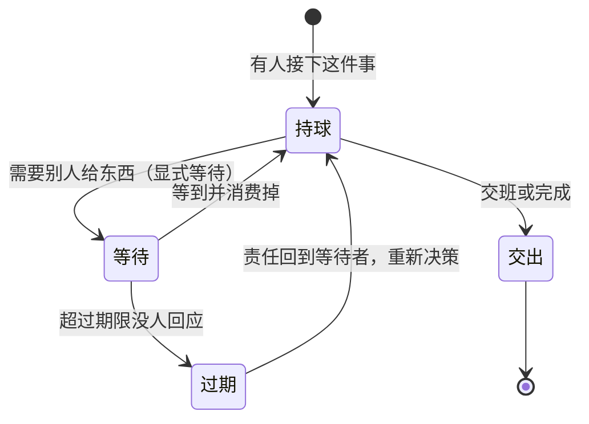

# 球权与等待责任

> **30 秒版**：多只猫协作时，最危险的状态不是「干活慢」，是「没人知道球在谁手上」。这一块给「现在由谁负责推进」和「我在等什么」建立显式、可持久、可过期的责任对象，让沉默和卡住区分得开。

## 边界

负责：球权的投影与归属、显式等待（typed wait）的生命周期与过期、单次消费、用户取消时的终止事件、以及「完成的原始投递必须立刻交付」这条新鲜度边界。

不负责：把消息投递给谁（那是 [对话与投递内核](./conversation-kernel.md) 的队列）；谁有能力接（那是 [猫与身份](./cats-and-identity.md) 与路由）；等待时该不该做别的事（那是猫自己的判断）。

## 块内组件

| 部分 | 一句话 | 什么时候读 | 文档 |
|---|---|---|---|
| 球权投影 | 从执行与等待事实推导出「球在谁手上」的读模型 | 改面板显示、查「为什么界面说没人持球」 | [ball-custody](https://github.com/zts212653/clowder-ai/tree/main/packages/api/src/domains/ball-custody/)), [ball-custody cell](https://github.com/zts212653/clowder-ai/blob/main/docs/architecture/ownership/cells/ball-custody.md)) |
| 显式等待 | 有类型、有 owner、会过期、只能被消费一次的等待对象 | 加一种新的等待理由、排查「等待永远不会结束」 | [ball-custody cell](https://github.com/zts212653/clowder-ai/blob/main/docs/architecture/ownership/cells/ball-custody.md)) |
| 唤醒恢复 | 进程重启或执行者退出后，把悬空的等待捡回来 | 重启后球权状态不对 | [ManagedCommandWakeRecoverySweep](https://github.com/zts212653/clowder-ai/tree/main/packages/api/src/domains/ball-custody/)) |
| 续接载体 | 等待结束后，下一次调用要带上的不可变上下文 | 改「续接时猫还记得什么」 | [wait-continuation-carrier](https://github.com/zts212653/clowder-ai/tree/main/packages/api/src/domains/ball-custody/)) |
| 新鲜度边界 | 已完成的原始产出必须立刻交付，补充作为后续追加回复 | 改「补发/追投」语义 | [transport cell](https://github.com/zts212653/clowder-ai/blob/main/docs/architecture/ownership/cells/transport.md)) |

排队与投递的执行细节（谁在等、按什么顺序、如何被唤醒）归 [对话与投递内核](./conversation-kernel.md) 的队列账本；这一块只拥有「责任」这一个维度：`dispatch` 负责把活送到，`ball-custody` 负责说清谁该动。

## 怎么运转

三个状态的区别是这一块存在的全部理由。**持球**表示有人正在推进；**等待**表示有人明确负责、正在等一件具体的事；**过期**表示原本的等待理由已经不作数了，而责任不能被悄悄丢掉，必须回到等待者手上重新决策。没有这一层，界面只能显示「最后一条消息」——于是「猫在思考」和「猫早就死了」看起来一模一样。

## 坑

**把「消息发出去了」当成「责任交接了」** → 球权没有任何变化，两侧都以为对方在推进，事情停在中间 → 责任转移要有显式的接受动作，不靠消息可见性推断。

**等待没有过期时间** → 等了三天还是一个漂亮的「等待中」，用户看到的是一台卡住的机器 → 每个等待都必须带期限，过期后责任回到等待者。

**进程重启后信任内存里的等待** → 重启丢掉全部等待，界面显示无事发生 → 等待要落在持久账本里，启动时由恢复扫描捡回（相关实现见 [balls custody 目录](https://github.com/zts212653/clowder-ai/tree/main/packages/api/src/domains/ball-custody/))）。

**用条件唤醒伪装成定时任务** → 用户看到的是「定时任务」而实际语义是「等某个条件成立」，判断完全错位（这是历史上真实发生的界面误标） → 展示层必须区分「等条件」和「等时间」，两种等待的取消方式不同。
