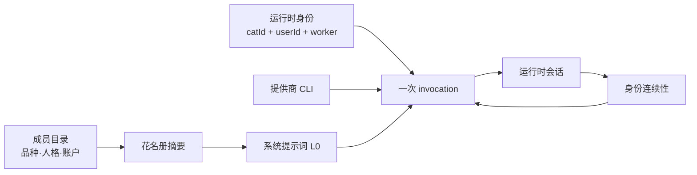

# 猫与身份

> **30 秒版**：Clowder 里的「猫」不是一次对话，而是一个有名字、有品种、有性格、有模型的长期成员。这一块管三件事：成员是谁（花名册与人格）、它此刻跑在哪个运行时会话里、以及它背后接的是哪家 CLI / 哪个模型。

## 边界

负责：成员目录与人格配置、花名册与能力画像、每只猫的运行时身份与会话绑定、跨会话与上下文压缩后的身份连续性、以及 agent CLI 提供商（Claude Code / Codex / Gemini / Antigee / opencode / Kimi 等）的接入与调用。

不负责：它记得什么（交给 [记忆与证据](./memory-and-evidence.md)）；它刚说了什么（交给 [对话与投递内核](./conversation-kernel.md)）；页面上的「看得见的猫」怎么画（交给 [在场·生活与作品](./presence-and-works.md)）。

## 业务场景

你想加第二只猫。你在设置里选一个品种，填名字和性格，选一个模型账户——几分钟后 Hub 的花名册里多了一只猫，你在任意 thread 里 `@` 它就能说话。这三步背后是三个不同的系统：品种与人格是**配置**，账户与凭据是**身份**，能说话是**运行时**。新人最常把它们混成一个「猫对象」，于是改一处以为全都改了。

## 块内组件

| 部分 | 一句话 | 什么时候读 | 文档 |
|---|---|---|---|
| 成员目录 | 本实例有哪些猫、各自品种与人格（`.cat-cafe/cat-catalog.json`） | 加成员、改人格、查「这只猫哪来的」 | [cat-catalog-store](https://github.com/zts212653/clowder-ai/blob/main/packages/api/src/config/cat-catalog-store.ts)), [cat-template.json](https://github.com/zts212653/clowder-ai/blob/main/cat-template.json)) |
| 花名册与能力画像 | 注入每只猫系统提示词的队友清单，带中性化摘要避免路由偏见 | 改「猫怎么知道队友会什么」 | [identity-session cell](https://github.com/zts212653/clowder-ai/blob/main/docs/architecture/ownership/cells/identity-session.md)) |
| 运行时身份 | 一次 invocation 属于哪只猫、哪个 user、哪个 worker | 排查身份混淆、越权 | [callback-auth cell](https://github.com/zts212653/clowder-ai/blob/main/docs/architecture/ownership/cells/callback-auth.md)) |
| 运行时会话 | 猫的会话绑定、外部 runtime session 登记、会话连续性 | 重启后上下文断了 / 串了 | [services/session](https://github.com/zts212653/clowder-ai/tree/main/packages/api/src/domains/cats/services/session/)) |
| 提供商接入 | 各家 agent CLI 的调用形态与能力差异 | 接新 CLI、修某家特有 bug | [identity-session cell](https://github.com/zts212653/clowder-ai/blob/main/docs/architecture/ownership/cells/identity-session.md)) |
| 单猫临时档位 | per-thread 的模型/思考强度覆盖 | 「这个 thread 想让它更用力一点」 | [ROADMAP F262](https://github.com/zts212653/clowder-ai/blob/main/docs/ROADMAP.md)) |
| 打包分发的猫 | 以声明式包形式分发人格与技能 | 做一只可分享的猫 | [domains/packs](https://github.com/zts212653/clowder-ai/tree/main/packages/api/src/domains/packs/)), [ADR-021](https://github.com/zts212653/clowder-ai/blob/main/docs/decisions/021-f129-pack-system-architecture.md)) |

## 怎么运转

关键点：**身份先于一切**。一次调用进来时，系统先确定「这是哪只猫、替谁干活」，再决定给它看什么上下文、允许它做什么、把回执算在谁头上。把这一步做错，后面所有审计、追溯和权限判断都会跟着错，而且错得很安静。

## 坑

**用 GitHub 登录名判断「是不是同一只猫」** → 一家里所有猫共用同一个账号，跨个体 review 会被误判成自审，或者自审被当成交叉审 → 跨个体判据是**猫的身份**，不是登录账号；两个人格不同的猫就算同一个账号也是跨个体。

**以为「换了模型账户」等于「换了猫」** → 人格、历史、记忆和别人的印象全部错位 → 账户是猫的一个属性，换账户改属性，不要新建一只猫。

**把 provider 的特有行为写进核心** → 每接一家新 CLI 就要改核心路由和类型联合，越接越慢（这是 F241 立项的直接原因） → 新增提供商做成插件/运行时接入，核心只认契约。

**上下文压缩之后假设猫还记得** → 它不记得，而且不会告诉你它不记得 → 需要跨压缩存活的东西必须走持久层（见 [记忆与证据](./memory-and-evidence.md)），不能靠「刚才说过」。

> 待确认：`packs` 目前是 `packages/api/src/domains/packs/` 下的一个域，不是独立包；它和插件框架的边界（谁能声明资源、谁能被授权）需要仓库主人确认后再细写。
