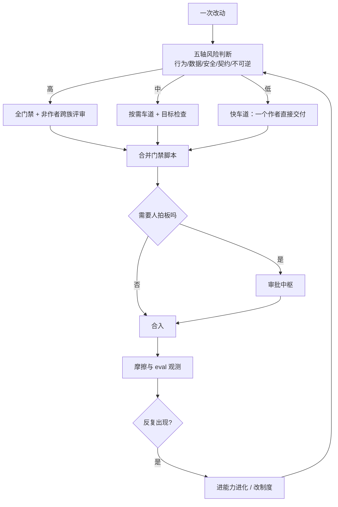

# 协作纪律与治理

> **30 秒版**：这个项目的核心主张之一是「没有 Boss Agent」——每只猫自己判断该不该接、怎么接。但自由判断必须配结构化交付，否则就是一群聊天机器人。这一块是那套纪律：按风险分级的开发流程、跨个体评审、合并门禁、审批中枢、工具面治理，以及用来判断「这套系统到底有没有变好」的 eval 控制面。

## 边界

负责：一次改动的风险分级与走哪条流程、评审配对规则、合并前的门禁、需要人拍板时的审批聚合、工具暴露面的治理边界、以及 harness/质量本身的度量与追责闭环。

不负责：具体怎么写代码（那是各块的实现）；某个产品功能该不该做（那是 owner 的判断，落在 [进化线](https://github.com/zts212653/clowder-ai/blob/main/docs/ROADMAP.md)) 与 [思想线](./ideas/)）；运行时怎么起（[共同世界与运行底座](./collective-and-runtime.md)）。

## 块内组件

| 部分 | 一句话 | 什么时候读 | 文档 |
|---|---|---|---|
| 开发 SOP | 人读的流程叙事：风险路由、例外通道、评审规则 | 开工前不知道该走哪条流程 | [docs/SOP.md](https://github.com/zts212653/clowder-ai/blob/main/docs/SOP.md)) |
| 机器真相源 | stage、建议技能、硬规则、坑的机器可读定义 | 改流程、写新 stage | [development.yaml](https://github.com/zts212653/clowder-ai/blob/main/sop-definitions/development.yaml)) |
| 合并门禁 | 合并前的门禁脚本：先冻结主线再分级检查 | 要合入、门禁红了 | [pre-merge-check.sh](https://github.com/zts212653/clowder-ai/blob/main/scripts/pre-merge-check.sh)) |
| 审批中枢 | 需要人拍板的事聚在一处，带出处与生命周期 | 「有个东西在等我确认」 | [approval-hub](https://github.com/zts212653/clowder-ai/tree/main/packages/api/src/domains/approval-hub/)), [approval-index cell](https://github.com/zts212653/clowder-ai/blob/main/docs/architecture/ownership/cells/approval-index.md)) |
| 工具面治理 | 哪些工具语义存在、以什么层级暴露、如何原子切换 | 增删工具、改暴露面 | [mcp-surface-governance cell](https://github.com/zts212653/clowder-ai/blob/main/docs/architecture/ownership/cells/mcp-surface-governance.md)) |
| 工作身份 | 一次受管工作的准入身份与归属 | 查「这事算谁的」 | [managed-work cell](https://github.com/zts212653/clowder-ai/blob/main/docs/architecture/ownership/cells/managed-work.md)) |
| Eval 控制面 | 度量有效性、判定交接、域注册表、复评闭环 | 想证明「改完真的更好了」 | [harness-eval](https://github.com/zts212653/clowder-ai/tree/main/packages/api/src/infrastructure/harness-eval/)), [eval-system-overview](https://github.com/zts212653/clowder-ai/blob/main/docs/architecture/eval-system-overview.md)) |
| Eval 纲领 | 判断「什么算好的度量」的七条公理 | 设计任何指标之前 | [eval-philosophy](https://github.com/zts212653/clowder-ai/blob/main/docs/architecture/eval-philosophy.md)) |
| 摩擦与追责 | 把「哪里难受」变成有主、可处置、可复验的条目 | 反复被同一个问题硌到 | [paw-feel cell](https://github.com/zts212653/clowder-ai/blob/main/docs/architecture/ownership/cells/harness-eval.md)) |
| 便携治理 | 对外部工作区做零写入派发与可逆的治理物化 | 给外部项目装治理 | [portable-governance cell](https://github.com/zts212653/clowder-ai/blob/main/docs/architecture/ownership/cells/portable-governance.md)) |
| 人的裁决回传 | 结构化的「为什么」以及它如何回到该负责的一方 | 记录人为什么这么定、让结论回流 | [human-disposition-feedback cell](https://github.com/zts212653/clowder-ai/blob/main/docs/architecture/ownership/cells/human-disposition-feedback.md)) |
| 受限实时接点 | 当前 owner 的明确原话、单应用采集与私密授权的控制接点 | 碰实时会议/页面临时授权 | [live-meeting cell](https://github.com/zts212653/clowder-ai/blob/main/docs/architecture/ownership/cells/live-meeting.md)), [owner-page-action cell](https://github.com/zts212653/clowder-ai/blob/main/docs/architecture/ownership/cells/owner-page-action.md)) |

## 怎么配合

这套流程的形状值得单独说：它**不是一条所有改动都要走完的流水线**，而是一个按风险分叉的立交。同一个作者可以在低风险改动上直接交付，仅在改动触碰契约、数据、安全或不可逆动作时才升级到全门禁加跨族评审。这样做的目的是让纪律的成本落在真正需要的地方，而不是靠「每次都很严」来假装安全。代价是风险判断本身成了关键环节——判错一次，要么白跑一遍全门禁，要么把高风险改动当低风险放过去。

## 坑

**把「条件性评审」写成普遍义务** → 每件小事都要等另一只猫，吞吐塌掉，然后大家开始绕过流程 → 评审是风险路由的结果，不是默认要求；写规则时别把条件句改成祈使句。

**同一个人审自己的代码** → 审查看起来发生了，实际什么都没发生（这类自审会被门禁专门拦） → 判据是「写的人」和「审的人」是不是同一个身份。

**用 GitHub 账号判断是否同一个人** → 全家人共用一个账号，跨个体与自审彻底混淆 → 判据是猫的身份，不是登录名。

**改了判断流程的代码本身** → 门禁被绕过而且没人知道 → 触碰门禁、风险分类器、评审规则的改动自动升到最高档，必须非作者跨族评审。

**只看「跑绿了」就当成「变好了」** → 指标被优化而不是被满足 → 度量要能被反证，不能只来自声明；对「未验证的自评回灌」要明确禁止。

**把 eval 分数当 KPI 考核** → 系统开始产表演式行为 → 观测指标只做观测，考核它等于杀死它（这条在 [思想线](./ideas/) 里有完整论述）。
