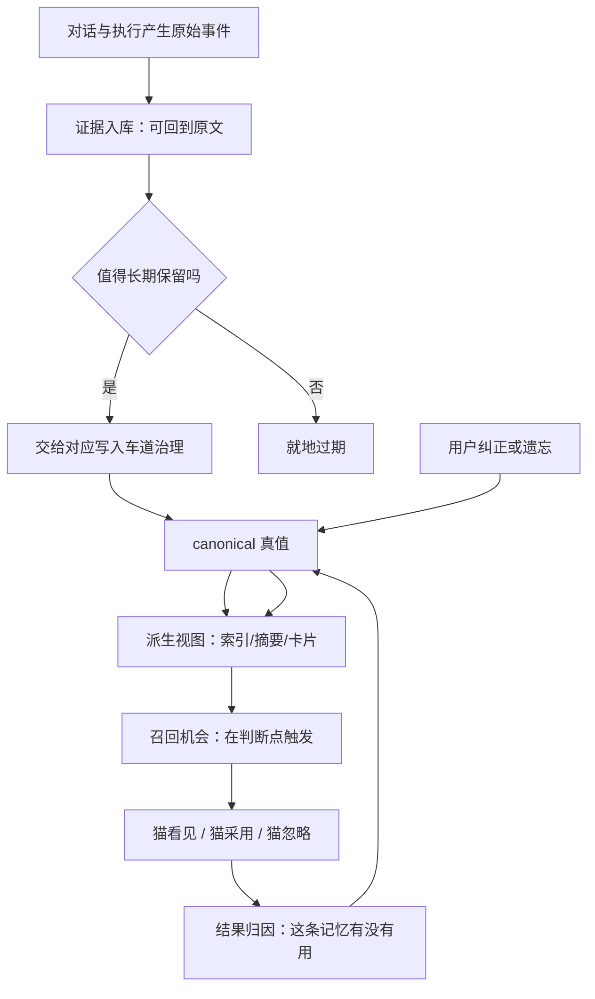

# 记忆与证据

> **30 秒版**：这不是「把聊天记录塞回提示词」。它是一条有权力边界的循环：先保存能回到原文的证据，把值得长期保留的内容交给对应车道治理，用可重建的索引和摘要加速理解，让猫在明确的判断点收到一次有界的召回或写入机会，最后让纠正、遗忘和权限变化从源头传播到所有派生读面。

## 边界

负责：证据的存储与索引、写入机会与召回机会的裁定、canonical 真值与派生视图的分层、上下文呈现、纠错与遗忘的传播、以及「这条记忆到底帮没帮上忙」的归因。

不负责：猫的身份与人格（交给 [猫与身份](./cats-and-identity.md)）；对话本身（交给 [对话与投递内核](./conversation-kernel.md)）；记忆质量的评测体系（交给 [协作纪律与治理](./governance-and-gates.md) 里的 eval 控制面）。

## 块内组件

| 部分 | 一句话 | 什么时候读 | 文档 |
|---|---|---|---|
| 证据库 | 每条记忆都能回到原始出处（SQLite + 全文检索 + 向量） | 改存储、查「这条记忆哪来的」 | [domains/memory](https://github.com/zts212653/clowder-ai/tree/main/packages/api/src/domains/memory/)), [memory-system-overview](https://github.com/zts212653/clowder-ai/blob/main/docs/architecture/memory-system-overview.md)) |
| 写入车道 | 不同种类的记忆走不同治理通道，各自有 owner | 加一种新的可记忆内容 | [memory-write-lane-census](https://github.com/zts212653/clowder-ai/blob/main/docs/architecture/memory-write-lane-census.md)) |
| 召回与 cue | 在明确判断点给出一次有界的「要不要想起来」 | 改「猫什么时候会想起旧事」 | [memory-cue-source-map](https://github.com/zts212653/clowder-ai/blob/main/docs/architecture/memory-cue-source-map.md)) |
| 派生视图 | 摘要、卡片、索引等可重建视图，带失效传播 | 改缓存、查「为什么界面还显示旧摘要」 | [memory-derived-view-contract](https://github.com/zts212653/clowder-ai/blob/main/docs/architecture/memory-derived-view-contract.md)) |
| 纠错与遗忘 | 用户说「忘了这条」时的传播路径 | 实现删除/遗忘/纠错 | [memory 域](https://github.com/zts212653/clowder-ai/tree/main/packages/api/src/domains/memory/)), [ADR-007](https://github.com/zts212653/clowder-ai/blob/main/docs/decisions/007-cascade-delete-semantics.md)) |
| 关系记忆 | 关于人（而不是关于任务）的记忆 | 改「猫怎么越认识你」 | [memory cell](https://github.com/zts212653/clowder-ai/blob/main/docs/architecture/ownership/cells/memory.md)) |
| 记忆的导航入口 | 记忆子系统的专用 atlas | 要系统理解记忆的六层与八个模块 | [memory/README](https://github.com/zts212653/clowder-ai/blob/main/docs/architecture/memory/README.md)) |

## 怎么运转

这条环里最关键的一步是 **canonical 与派生的分离**。摘要、卡片、索引都是可以随时丢掉重建的；只有原始证据和治理过的真值不能丢。因此「用户改了意见」或「用户要求忘掉」时，动作必须从源头发出、向所有派生面传播——反过来（先改缓存）就会出现「你明明让我忘了，它还在提」。

## 坑

**把聊天记录直接拼进提示词当成记忆** → 上下文爆掉，且模型分不清「刚才说的」和「很久以前说的」 → 记忆要经过筛选与呈现层，不做原始回放。

**让派生视图变成第二真相源** → 用户纠正之后旧摘要还在被读，出现两套互相矛盾的事实 → 派生视图只允许可重建，失效要传播、要能 fail-closed 回源。

**在不相关的时刻也触发召回** → 猫说话开始带无关旧事，用户体感是「它在硬套记忆」 → 召回机会只挂在明确的判断点上，其余时候保持安静。

**以为删了记录就等于忘了** → 索引、摘要、画像里还留着派生痕迹 → 遗忘要沿派生链传播，删除是级联语义而不是单表操作。
