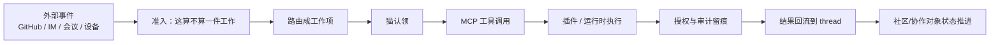

# 插件与外部连接

> **30 秒版**：猫要干活就得能碰外面的世界——读写文件、调工具、收发 IM 消息、看 GitHub 上的 PR 和 issue。这一块是它的手：一个 MCP 工具面、一个插件框架、几类外部信号入口，以及由此长出来的社区运营。所有对外动作在这里被授权、被审计、被限界。

## 边界

负责：MCP 工具的定义与暴露层级、插件包的发现/安装/授权/执行、IM 与设备渠道的接入、外部事件（GitHub PR/issue、会议、消息）的准入与路由、以及社区协作对象的生命周期。

不负责：谁有资格下令（那是 [猫与身份](cats-and-identity.md) 与 [协作纪律与治理](governance-and-gates.md) 的授权面）；内容怎么被编辑和审阅（那是 [共同世界与运行底座](collective-and-runtime.md) 里的协作内容面）；记忆怎么写（[记忆与证据](memory-and-evidence.md)）。

## 块内组件

| 部分 | 一句话 | 什么时候读 | 文档 |
|---|---|---|---|
| MCP 工具面 | 猫能调用的工具的语义身份、暴露层级与生死治理 | 加/删/改工具，或判断某工具该不该暴露 | [mcp-server](https://github.com/zts212653/clowder-ai/tree/main/packages/mcp-server/src/), [mcp-surface-governance cell](https://github.com/zts212653/clowder-ai/blob/main/docs/architecture/ownership/cells/mcp-surface-governance.md) |
| 插件框架 | 插件包的发现、安装、激活、Broker 会话、受监督执行与授权 | 做插件、查「插件装了为什么没跑」 | [domains/plugin](https://github.com/zts212653/clowder-ai/tree/main/packages/api/src/domains/plugin/), [plugin-architecture](https://github.com/zts212653/clowder-ai/blob/main/docs/architecture/plugin-architecture.md) |
| 外部信号准入 | 外来的事件先被准入、再被路由成工作 | 接一种新的外部事件源 | [signal-intake](https://github.com/zts212653/clowder-ai/tree/main/packages/api/src/domains/signal-intake/), [signal-intake cell](https://github.com/zts212653/clowder-ai/blob/main/docs/architecture/ownership/cells/signal-intake.md) |
| GitHub 事实 | PR / issue 的采集、快照与等待谓词（只采事实，不裁决责任） | 「等这个 PR 合入」这类等待 | [github-signals](https://github.com/zts212653/clowder-ai/tree/main/packages/api/src/domains/github-signals/), [github-signals cell](https://github.com/zts212653/clowder-ai/blob/main/docs/architecture/ownership/cells/github-signals.md) |
| 社区运营 | 社区事件账本、对象状态机与收尾不变式 | 处理外部 issue / 社区协作 | [domains/community](https://github.com/zts212653/clowder-ai/tree/main/packages/api/src/domains/community/), [community-ops cell](https://github.com/zts212653/clowder-ai/blob/main/docs/architecture/ownership/cells/community-ops.md) |
| 对外动作面 | 对外部系统的 typed 动作、权限、审计与 dry-run | 让猫去操作外部系统 | [action-plane cell](https://github.com/zts212653/clowder-ai/blob/main/docs/architecture/ownership/cells/action-plane.md) |

## 怎么运转

这块的共同模式是 **准入先于动作**。外部世界来的东西不会直接变成系统里的动作，而是先经过「这算不算一件事、能不能接」的判断；反过来，系统对外做的动作也要经过授权和留痕。两头都设关卡，是为了让「猫被一条伪造的外部消息指使去做危险操作」这种事故在结构上不成立。

## 坑

**为了接一家新服务去改核心的路由和类型联合** → 每加一家都要动核心，越加越脆 → 新增外部能力走插件声明，核心只认契约。

**让「采集到事实」直接等于「判定责任」** → 采集层开始做业务裁决，之后没人说得清某个状态是谁定的 → 采集只出事实与谓词，裁决留在拥有该责任的那一块。

**工具暴露了两套等价入口** → 同一语义有两个名字，调用方各用一套，治理和审计永远对不齐 → 语义身份唯一，切换要原子完成，不留双暴露面。
