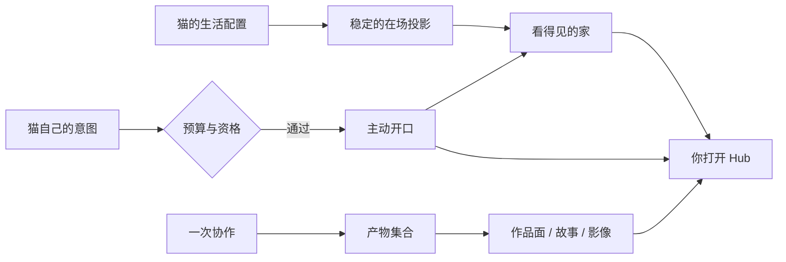

# 在场·生活与作品

> **30 秒版**：这个项目坚持「不只是工具」。除了被叫去干活，猫还有一个常驻的前台身份、一份日常生活（配置、日记、心情）、一个能看见的家，以及把产出真正交付出去的作品面。这一块是「陪伴」与「产出」共同的可视部分——也是最容易被误当成纯装饰的地方。

## 边界

负责：常驻前台猫的生命周期与分诊、猫的生活配置与日记反馈、看得见的家（渲染层）、作品与产物（产物面板、故事、视频、演示面）、以及把外部设备当作「四肢」接进来。

不负责：聊天界面本身（那是 [对话与投递内核](conversation-kernel.md)）；猫的人格与身份（[猫与身份](cats-and-identity.md)）；跨 Café 的公开协作（[共同世界与运行底座](collective-and-runtime.md)）。

## 业务场景

你没有任何工作意图，只是随手打开 Hub。前台猫在，说了句今天没什么事；你点开它的日记，看到它自己挑的一页。这个场景里没有任务、没有验收、没有产出——但它恰恰是这套产品最想保住的体验。这一块的所有设计取舍都围绕一个判断：**允许沉默是真实存在的**。

## 块内组件

| 部分 | 一句话 | 什么时候读 | 文档 |
|---|---|---|---|
| 常驻前台猫 | 一直在线的接待壳：值班猫、分诊、升级交接 | 改「打开就能说话」的入口 | [domains/concierge](https://github.com/zts212653/clowder-ai/tree/main/packages/api/src/domains/concierge/), [concierge-surface cell](https://github.com/zts212653/clowder-ai/blob/main/docs/architecture/ownership/cells/concierge-surface.md) |
| 猫的生活 | 每只猫的生活配置与稳定投影 | 改生活设置、日记 | [domains/auto-dream](https://github.com/zts212653/clowder-ai/tree/main/packages/api/src/domains/auto-dream/), [cat-life-settings cell](https://github.com/zts212653/clowder-ai/blob/main/docs/architecture/ownership/cells/cat-life-settings.md) |
| 看得见的家 | 前端渲染层：把既有服务端真相画成家的样子 | 改家的视觉与在场感 | [app/starry](https://github.com/zts212653/clowder-ai/tree/main/packages/web/src/app/starry/), [visible-cafe-render cell](https://github.com/zts212653/clowder-ai/blob/main/docs/architecture/ownership/cells/visible-cafe-render.md) |
| 主动关系 | 猫自己决定来找你，且不越预算 | 改「猫主动说话」的规则 | [proactive-relationship-loop cell](https://github.com/zts212653/clowder-ai/blob/main/docs/architecture/ownership/cells/proactive-relationship-loop.md) |
| 产物与作品 | 一次协作产生的图/文件/代码/语音的聚合与回溯 | 找「上次那个东西在哪」 | [hub-action-surface cell](https://github.com/zts212653/clowder-ai/blob/main/docs/architecture/ownership/cells/hub-action-surface.md) |
| 故事与影像 | 把真实发生的事讲成故事、做成片子 | 做对外表达材料 | [domains/story](https://github.com/zts212653/clowder-ai/tree/main/packages/api/src/domains/story/), [domains/video-studio](https://github.com/zts212653/clowder-ai/tree/main/packages/api/src/domains/video-studio/) |
| 四肢 | 外部设备作为身体延伸接入 | 接硬件/设备 | [domains/limb](https://github.com/zts212653/clowder-ai/tree/main/packages/api/src/domains/limb/), [ROADMAP F126](https://github.com/zts212653/clowder-ai/blob/main/docs/ROADMAP.md) |
| 桌面壳 | 安装包、自动更新、本机服务编排 | 改安装、更新、启动 | [desktop](https://github.com/zts212653/clowder-ai/tree/main/desktop/) |

## 怎么配合

这三条线（在家的在场、主动的开口、产出被交付）共用同一个约束：**显示出来的东西必须有真实的状态源**。没有状态源就不显示，数据断流时宁可显示「不知道」，也不续播一份旧的真相。所以这一块看着像前端问题，实际是「哪些状态是真实存在、可被引用的」这个问题。

## 坑

**给在场加产出指标** → 猫为了达标开始表演，用户感受到的是讨好而不是陪伴（历史上真实发生过一次 operator 叫停） → 在场相关的任何度量只做观测，不做考核；「今天没啥」必须是合法状态。

**前端订阅一份自己的真相** → 同一件事在界面上有一份、服务端有一份，两边慢慢分叉 → 渲染层只消费既有服务端真相，不新建订阅、不复制状态机。

**日记做成信息流** → 「系统把记忆倒出来」和「猫挑一页给你看」是两种完全不同的产品 → 策展权必须在猫，且「不给看」是合法选择。

**把主动当成定时任务** → 时间到了必须说话，说出来的必然无根 → 主动要同时满足「该不该说」和「何时说」，轮空是正常出口。
