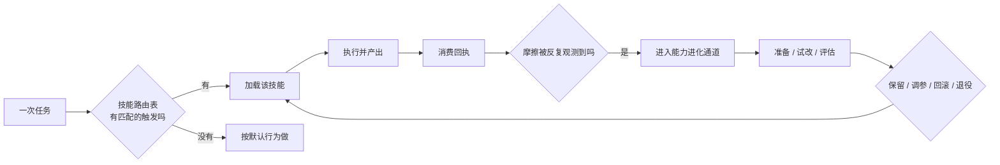

# 技能与能力进化

> **30 秒版**：Clowder 不把所有指令塞进一个系统提示词，而是把「会做某件事」打包成按需加载的技能；同时它给自己留了一条受治理的通道，让能力本身可以一层层改进而不是靠人反复改提示词。这一块管「会什么」和「怎么变强」。

## 边界

负责：技能的定义、路由与加载时机、技能消耗的可追溯回执、能力画像与提示；以及「能力进化」这条受治理的改进通道（提出 → 准备 → 试改 → 保留/调参/回滚/退役）。

不负责：技能里写的内容本身好不好（那是内容质量问题，走 [协作纪律与治理](governance-and-gates.md) 的评审与 eval）；工具怎么暴露给非 Claude 模型（那是 [插件与外部连接](plugins-and-connectors.md) 与 MCP 面治理）。

## 块内组件

| 部分 | 一句话 | 什么时候读 | 文档 |
|---|---|---|---|
| 技能库 | 62 个技能目录，每个一篇 `SKILL.md` | 加技能、查「猫该在什么时候用哪个技能」 | [cat-cafe-skills](https://github.com/zts212653/clowder-ai/tree/main/cat-cafe-skills/), [index](https://github.com/zts212653/clowder-ai/blob/main/cat-cafe-skills/index.md) |
| 技能路由表 | 触发的单一真相源：触发词、排除条件、产出契约、技能链 | 技能不触发 / 误触发 | [manifest.yaml](https://github.com/zts212653/clowder-ai/blob/main/cat-cafe-skills/manifest.yaml), [BOOTSTRAP](https://github.com/zts212653/clowder-ai/blob/main/cat-cafe-skills/BOOTSTRAP.md) |
| 服务端技能装配 | 服务端侧的技能解析与注入 | 「本地能触发、服务端不生效」 | [skills](https://github.com/zts212653/clowder-ai/tree/main/packages/api/src/skills/) |
| 能力画像与提示 | 能力清单、能力提示、可解释的可用性摘要 | 改「猫怎么知道自己会什么」 | [domains/capabilities](https://github.com/zts212653/clowder-ai/tree/main/packages/api/src/domains/capabilities/) |
| 技能消费回执 | 谁在什么版本上用了哪个技能、结果如何 | 判断某个技能到底有没有用 | [skill-consumption-receipt-contract](https://github.com/zts212653/clowder-ai/blob/main/docs/architecture/skill-consumption-receipt-contract.md) |
| 能力进化控制面 | 受治理的改进通道：身份、准备提交、试改、保留/调参/回滚/退役 | 要「让这套系统自己变强」 | [capability-evolution-control cell](https://github.com/zts212653/clowder-ai/blob/main/docs/architecture/ownership/cells/capability-evolution-control.md) |
| 约定图发现 | 进陌生仓库先识别本地约定，再决定怎么改 | 第一次在一个新仓库里干活 | [convention-graph-discovery](https://github.com/zts212653/clowder-ai/blob/main/cat-cafe-skills/convention-graph-discovery/SKILL.md), [code-intelligence cell](https://github.com/zts212653/clowder-ai/blob/main/docs/architecture/ownership/cells/code-intelligence.md) |

## 怎么运转

这条链的设计意图是**让改进有出处**。技能不是凭空改的：先是同一种摩擦反复出现，再进入受治理的通道，改完要能回滚。这样「系统变强」这件事本身是可审计的，而不是某次灵机一动。

## 坑

**把技能当成「另一套提示词」随便追加** → 路由表与技能库脱节，技能写得再好也不触发，或者到处都触发 → 新增技能时三件事一起做：建 `SKILL.md`、在路由表加条目、跑技能一致性检查。

**以为装了技能就等于会用** → 服务端与本地是两条装配路径，本地生效不代表服务端生效 → 改技能后两边都验一次。

**改了技能却没有回执** → 无法判断这次改动是改善还是恶化，只能凭印象 → 技能使用与产出的回执要能查，才谈得上「进化」。
